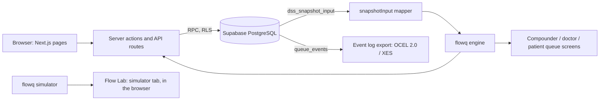

# 🏥 Clinic Management & Intelligent Healthcare System

An enterprise-grade clinic operating system and healthcare platform engineered with **Next.js (App Router)**, **TypeScript**, **Tailwind CSS**, and **Supabase (PostgreSQL & Storage)**. The system provides real-time queue intelligence, dual-mode clinical triage, paperless medical records, and role-tailored workflows for patients, doctors, compounders, and clinic administrators.

---

## 🌟 Key Modules & Core Capabilities

### 1. 🤖 Aura AI Healthcare Assistant
* **Dual-Mode Clinical Assistant:** Bidirectional voice (WebRTC via ElevenLabs) and real-time interactive text chat with live audio waveform visualization.
* **Intelligent Clinical Triage:** Evaluates symptoms, determines clinical urgency levels, and guides patients to the appropriate medical specialties.
* **Generative UI Action Cards:** In-chat interactive cards for appointment booking confirmation, prescription refills, and clinical escalation without leaving the conversation.
* **Automated Settlement Sync:** Background settlement loops capture transcripts and clinical attachments directly into patient records.

---

### 2. ⚡ Live Queue & Decision Support System (DSS)
* **Real-Time Dynamic Ordering:** Deterministic queue ordering engine considering priority statuses, check-in timestamps, and scheduled slot windows.
* **Wait Time & ETAs:** Dynamic calculation of expected visit durations and wait times based on historical consultation benchmarks.
* **Compounder Live Console:** 
  * Seamless chamber controls: *Call Next*, *Mark In Chamber*, *Consultation Done*, *Skip*, and *No-Show*.
  * Multi-session management: Start, pause, conclude, and restart multiple sessions per doctor in a single day.
  * Real-time metrics bar: Serving Inside, Present & Waiting, Rx Pending, and Visits Completed.
  * Proactive DSS suggestions with quick dismiss and confirmation actions.
* **Comprehensive Visit Details Modal:** Rich pop-up modal displaying full schedule timings, queue progress, and uploaded prescription documents.

---

### 3. 👥 Patient Portal & Records Vault
* **Online Booking & Slot Selection:** Easy appointment scheduling by doctor, specialty, and time slot.
* **Digital Appointment Slips:** Instant generation and PDF download for OPD tickets, payment receipts, and prescriptions.
* **Family Profile Management:** Book and manage appointments for family dependents under a single primary account.
* **Paperless Records Vault:** Upload, view, and organize medical documents, diagnostic imaging, and laboratory test reports.
* **Export Health Records:** One-click ZIP archive export and consolidated clinical health summary PDF generation.

---

### 4. 🩺 Doctor Chamber & Clinical Desk
* **Live Consultation Queue:** Instant visibility of patients waiting outside, consultation status, and priority tags.
* **Patient Medical History:** Timeline view of previous consultations, diagnoses, allergies, and uploaded reports.
* **Electronic Prescription Authoring:** Direct prescription generation with dosage instructions and visit completion triggers.

---

### 5. 🧪 Laboratory Module
* **Lab desk (technician role):** register a patient from a doctor's order, queue them for one or more lab lines (blood, urine, ECG, X-ray…), call, collect, and mark the report ready.
* **Lab line ETAs and routing:** each lab line shows an expected wait; patients with tests in several lines get a suggested visiting order (fasting tests first, then the shortest expected wait).
* **Doctor side:** the doctor sees which patients have lab orders ("Lab now / Later") and is offered a short report-review visit when the report is ready.
* **Report upload with vision AI:** an uploaded report image or document is read and its values are extracted into a structured result.

---

### 6. 🔬 Flow Lab and the `flowq` engine
The wait-time engine behind the queue is a separate, tested library in [`packages/flowq`](packages/flowq): wait-time engine, lab routing, a hospital-day simulator, OCEL 2.0 / XES event-log export, and a benchmark.
**Admin ▸ Flow Lab** (`/admin/flow-lab`) puts it inside the app:
* **Live: DSS vs full engine:** one doctor's live queue estimated both ways, side by side, with the range each one shows.
* **Simulator:** run a simulated clinic day in the browser (scenarios include one calibrated from a public hospital outpatient event log); compare estimators and lab routing policies; see which parameters are cited, derived or assumed.
* **Event log & process map:** directly-follows map of the real queue log with typical times, common paths, and OCEL 2.0 / XES download.

The engine has two modes, switched by an admin in **Admin ▸ Queue Settings**: the original *DSS rules* (default) and the *full engine* (counts people not yet arrived, uses mean visit lengths, builds a calibrated range).

---

### 7. 📑 Automated Health Data Extraction
* **Smart Medical Document Extraction:** Automated parsing of uploaded prescription images and diagnostic test results.
* **Structured Health Profiles:** Automatically extracts vitals, active medications, test results, and conditions into structured patient profiles.

---

### 8. 📊 Admin Management & Analytics
* **Doctor & Schedule Operations:** Configure doctor visiting hours, chamber allocations, and leave management.
* **Queue Performance Reports:** Detailed audit metrics on average patient wait times, doctor consultation speeds, and no-show rates.
* **Staff & User Role Administration:** Granular role-based access control (Admin, Doctor, Compounder, Lab technician, Patient) powered by PostgreSQL Row Level Security (RLS).

---

## 👥 Roles and where they start

| Role | Main screens |
|---|---|
| Patient | `/patient/dashboard`: book, live queue status, records, family members |
| Compounder (front desk) | `/compounder/queue`: check-in, call next, walk-ins, skip, no-show |
| Doctor | `/doctor/queue`, `/doctor/chamber`: live queue, consultation, lab orders, prescriptions |
| Lab technician | `/lab/queue`, `/lab/register`, `/lab/reports` |
| Admin | `/admin/dashboard`, live clinic board, queue/lab settings, reports, **Flow Lab** |

## 🏗️ Architecture



* All queue numbers come from one pure function (`flowq` engine) fed by one database snapshot (`dss_snapshot_input`), so every screen shows the same estimate.
* Every staff action is recorded in `queue_events` (append-only), which is also the source of the process-mining log.
* Access is enforced by PostgreSQL Row Level Security and role checks in the database functions, not only in the UI.

## 🛠️ Technology Stack

| Layer | Technology |
|---|---|
| **Framework** | Next.js 16 (App Router, Turbopack) |
| **Language** | TypeScript 5 |
| **UI & Styling** | React 19, Bootstrap 5 (vendored page styles), Tailwind CSS v4, Lucide Icons, Base UI |
| **Database & Auth** | Supabase (PostgreSQL with RLS, Triggers, RPCs, Storage) |
| **Voice & AI** | ElevenLabs Client, n8n Automation Engine |
| **PDF & Export** | jsPDF, html2canvas, fflate |
| **Testing & Quality** | Vitest, Testing Library, ESLint |

---

## 🚀 Getting Started

### Prerequisites
* **Node.js** v20 or higher, **npm** v10 or higher
* A **Supabase** project with all migrations in `supabase/migrations/` applied

### 1. Install
```bash
git clone https://github.com/suaib022/Clinic.git
cd Clinic
npm install
```

### 2. Environment
Copy [`.env.example`](.env.example) to `.env.local` and fill in the values (Supabase, OpenRouter, ElevenLabs, SSLCommerz sandbox). Never commit `.env.local`.

### 3. Run
```bash
npm run dev      # http://localhost:3000
```
Deployment notes (host-neutral): [`docs/DEPLOY.md`](docs/DEPLOY.md). Demo walkthrough: [`docs/DEMO.md`](docs/DEMO.md).

---

## 🧪 Testing & Verification

```bash
npm run test:unit   # engine, Flow Lab, UI and lab unit tests; needs no database (225 tests)
npm run lint
npm run build
```
`npm test` also runs the suites in `tests/*/db` and `tests/dss/api`, which talk to the **linked Supabase project** with dev-only test accounts (`DSS_DEV_SEED=1`). Run those only against a database you can safely write test data to.

### Reproduce the engine evaluation
```bash
npm run flowq:bench -- --scenario packages/flowq/scenarios/hospitalopd.json --days 100 --seed 1 --out out/bench-dss
npm run flowq:bench -- --scenario packages/flowq/scenarios/hospitalopd.json --days 100 --seed 1 --out out/bench-full \
  --engine-doctor '{"sumWith":"mean","expectArrivals":true,"showP":0.77,"walkInPerHour":2,"latenessMeanMin":-10,"latenessSdMin":10,"rangeMethod":"normal_sum","rangeCoverage":0.85,"historyWindow":60}'
```
The full set of experiments is in `packages/flowq/experiments/run-all.sh`; every scenario parameter is tagged cited / derived / assumption in `packages/flowq/scenarios/SOURCES.md`.

### What the evaluation shows (HospitalOPD-calibrated scenario, 100 simulated days, seed 1)
| Estimator for the doctor queue | MAE of start time | Range holds the real start |
|---|---|---|
| DSS rules | 20.9 min | 48.3% |
| Full engine | 16.8 min | 81.5% |
| Simplest baseline (history mean) | 17.2–17.4 min | no range |

The full engine is only slightly more accurate than a history-mean baseline; its main gain is a range that holds close to the 80% it is built for, where the DSS-rule range holds less than half the time. Values are from a simulation calibrated on public data, not measurements of this clinic.

---

## ⚠️ Known limitations
* The full-engine settings in Flow Lab are the values of the evaluation scenario, not this clinic's own; the admin can tune them in Queue Settings.
* Lint reports many `no-explicit-any` errors in older modules; the build and tests are unaffected.
* The simulator and event-log tools are research tooling around the app; the live app uses the engine, lab routing and the process-map view.

---

## 🔒 Security & Privacy
* **Row Level Security (RLS):** Strict database policies prevent unauthorized access across user roles.
* **Auditability:** Complete transaction history tracking for all queue movements, appointment status transitions, and medical record accesses.
* **Encrypted Storage:** Private signed URLs for patient medical files, lab tests, and prescription uploads.
* **Secrets:** all keys are read from environment variables; `.env.example` lists names only. Developer quick-login routes are disabled unless dev-only variables are set.
* **Event-log export:** admin only, read-only, pseudonymous IDs (no names).
